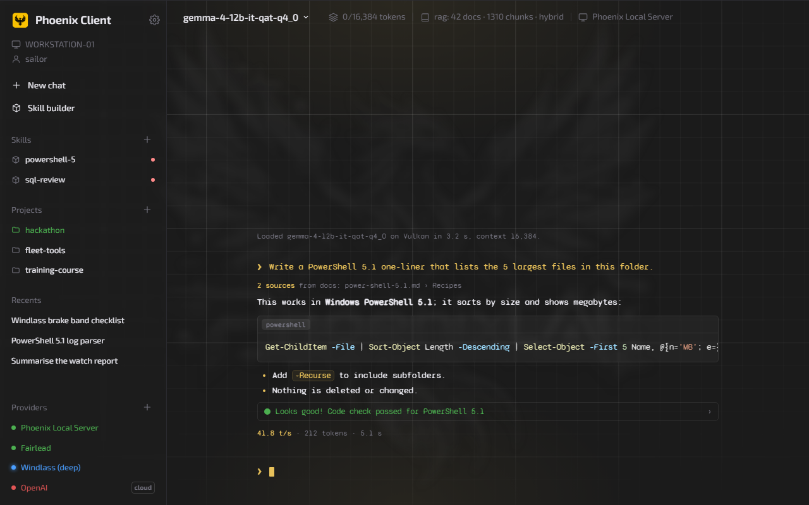
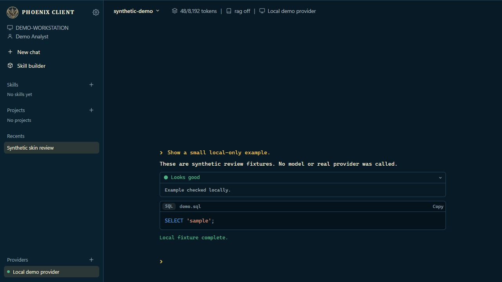
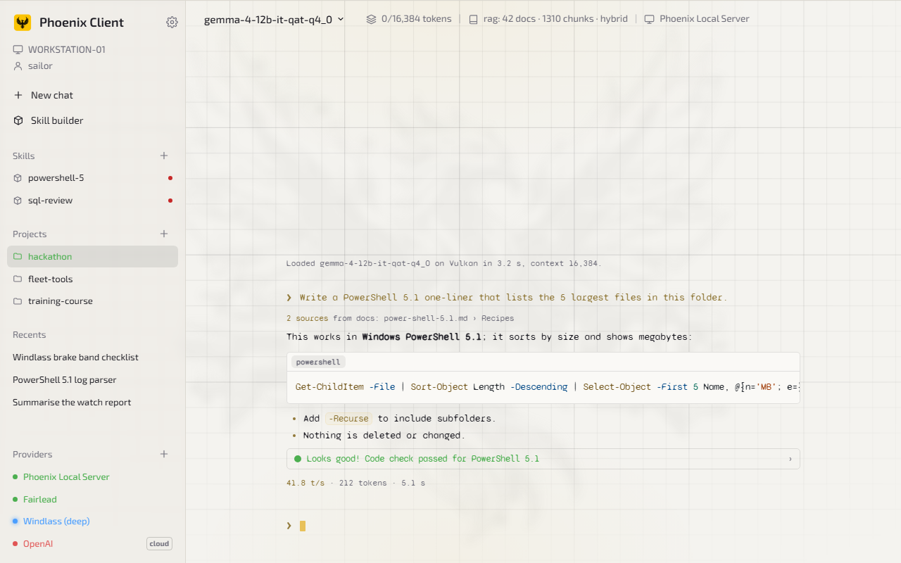
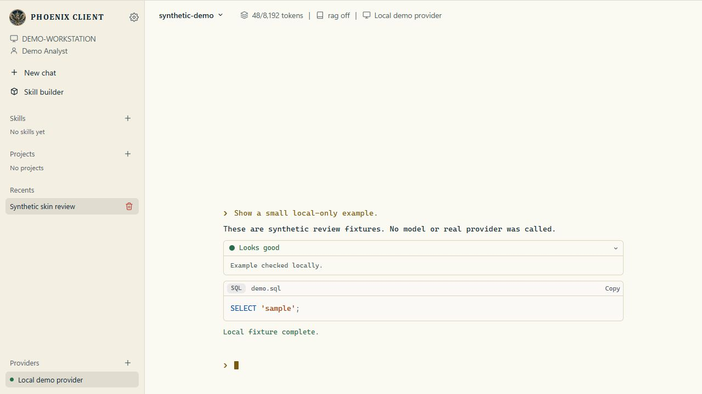
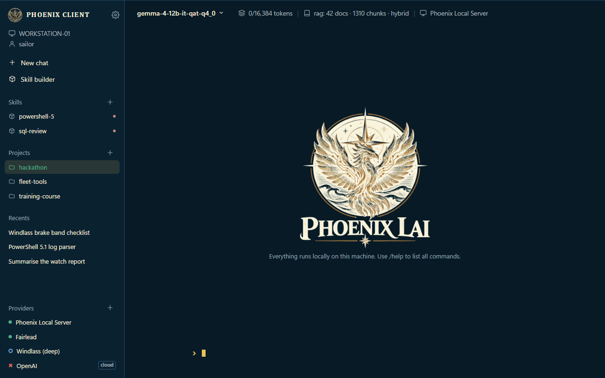
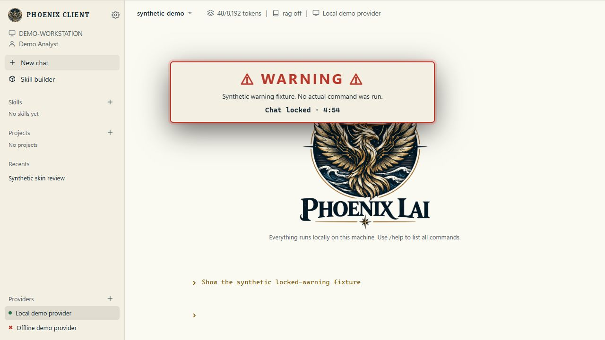

# Skins: Phoenix (default) and Fleet

Phoenix has two skins. **Phoenix** is Chris's own look and stays the default. **Fleet** is an optional second skin in
the shared FleetHacker look (navy and brass, Segoe UI and Cascadia Mono, the Fleet emblem frame), proposed in the
comms repo (`proposals/phoenix-fleet-skin.md`, discussion #29).

## Switching

| Where | How |
| --- | --- |
| Phoenix Client | `/skin fleet` or `/skin phoenix`, or Settings › appearance › skin. Saved with the other look settings. |
| Server console and dashboard | `skin fleet` or `skin phoenix` in the console (handled in the page, never sent to the server); the dashboard follows it. |
| VS Code panel | Not skinned: it follows VS Code's own theme. |

Every page carries `data-skin="phoenix"` or `data-skin="fleet"` on `<html>`.

## How it is built

- Phoenix's look is untouched: `chat.css` and `server.css` are not changed.
- `html/css/fleet-skin.css` is linked last on `chat.html`, `dashboard.html` and `console.html`. Every rule is scoped
  under `html[data-skin="fleet"]`, so it does nothing while the Phoenix skin is on.
- It mostly re-points Phoenix's own variables (`--bg`, `--side-bg`, `--box`, `--line`, `--text`, `--soft`, `--dim`,
  `--accent`, `--sans`, `--mono`, `--chat`) to the Fleet palette, in both Phoenix's dark mode and its light mode, plus
  overrides for the hard-coded colours.
- Fixed while Fleet is on: the accent (Phoenix's gold in dark, a darkened gold in light) and the chat font (Cascadia
  Mono). The accent picker and font choice are disabled for mouse and keyboard, announced with a note, and show the active Fleet values. Switching back restores the saved Phoenix font and accent.
- Hidden while Fleet is on: the grid, glows and watermark background.
- To remove the Fleet skin: delete `fleet-skin.css`, `assets/brand/fleet-*`, the three `<link>` lines and the
  `/skin` code (`SKINS` in `chat.js`, the `skin` lines in `console.js` and `dashboard.js`).

## Accessibility (from the Section 508 review in discussion #29)

| Condition | In the Fleet skin |
| --- | --- |
| Accent ink `#071a26` on the accent | Primary buttons use `--fl-accent-ink`: 10.3:1 dark, 6.1:1 light |
| Visible focus | A 2px brass `:focus-visible` ring on every control, including fields and menus that Phoenix sets to `outline: 0`. The message box keeps its block cursor as its focus sign |
| Control borders | Buttons and fields use `--fl-control-border` (at least 3:1), never the plain dividers |
| Status not by colour alone | Provider and server status dots also differ in shape: filled = up, ring = busy, cross = down, dashed ring = unknown; status text stays neutral. The model menu adds "loaded" and "too big for free memory" labels |
| Reduced motion | Under `prefers-reduced-motion`, animations stop, including the run-guard banner's flashing. Otherwise its warning keeps readable red text while the red glow flashes |

The corrected static checker reports no new text-contrast failures for the Fleet skin. Targeted browser checks found no text-contrast failures in the rendered dark/light client, settings and model menu, the warning banner, and the dark server console/dashboard fixtures. These checks use synthetic data and do not constitute complete Section 508 certification.

These conditions are met in the Fleet skin only. The review also found that the Phoenix skin needs the same focus,
contrast and motion fixes, whichever skin is the default; those are Chris's call and are not changed here.

## The emblem

`assets/brand/fleet-emblem-dark.png` and `fleet-emblem-light.png` (welcome screen) are the Phoenix LAI emblem in the
Fleet look: navy and brass, compass star and waves. The light version is shown in light mode. `fleet-mark.png` (side
panel and dashboard header) is the round medallion from the light emblem, with a thin brass ring from the skin. The
backgrounds are transparent and the welcome images are square; to change the emblem, replace these three files.

## Screenshots

Sample data from a mock back end; the same page and CSS as the real client.

| Phoenix (default) | Fleet |
| --- | --- |
|  |  |
|  |  |
| |  |

### Updated validation, 29 October 2026

- `src/run.ps1 -CheckOnly`: locality safeguards pass; backend and model rules are unchanged.
- JavaScript syntax checks pass for chat, console and dashboard.
- Browser interaction verified Fleet selection, dark/light switching, unavailable-model labels, native disabled appearance controls, a visible 2px keyboard focus ring, saved font restoration when returning to Phoenix, and Escape cancelling the preview.
- The shared checker correction passed 96 Windows PowerShell 5.1 tests, with one browser-dependent test skipped. Contrast thresholds are unchanged.
- Screenshot content is synthetic. No remote provider, real model, personal settings or production data was used.

