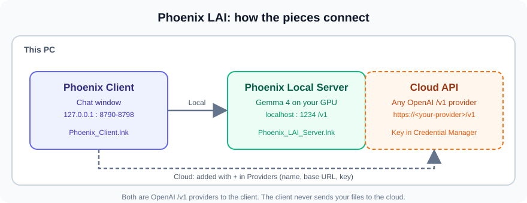
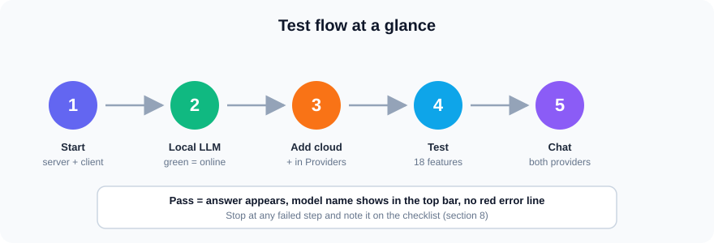
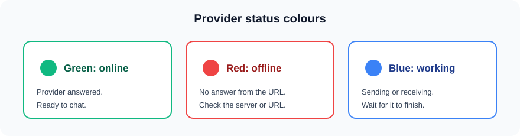
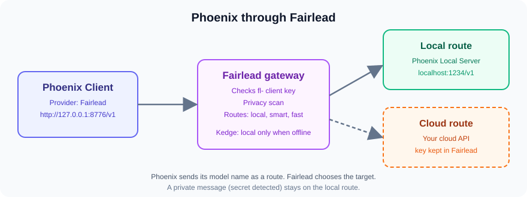

# Phoenix LAI: Tech Test Walkthrough

This guide tests Phoenix LAI end to end on one PC: the **Local LLM** (Gemma 4 on your GPU), a **Cloud API** (any OpenAI-compatible `/v1` provider), and the **Fairlead** gateway that routes between them. It takes about 45 to 60 minutes.



---

## 1. Before you start

| You need | Notes |
|---|---|
| Windows 10 or 11 with PowerShell 5.1 | Built in. Do not use PowerShell 7. |
| A GPU driver with Vulkan | Usually installed with the driver. |
| The Phoenix LAI folder | Downloaded from the repo or a zip you were given. |
| The Gemma model file | `models\gemma-4-12b-it-qat-q4_0.gguf`. |
| A cloud API base URL and key | From your provider. Keep the key private. |
| Chrome or Microsoft Edge | The chat opens in an app window. |

> **Privacy:** the cloud key is saved in Windows Credential Manager, never in a file. Use a test key with a spending limit where you can.

---

## 2. Start Phoenix

1. Double-click **`Phoenix_LAI.bat`** in the Phoenix folder.
   - First run creates the two shortcuts (`Phoenix_Client.lnk` and `Phoenix_LAI_Server.lnk`). This is normal.
2. Phoenix starts the **server** (models) and the **client** (chat window).
3. Wait until the chat window opens.

If you only need the server later, double-click **`Phoenix_LAI_Server.lnk`**. Use **`Phoenix_Client.lnk`** for the chat.



---

## 3. Test the Local LLM

### 3.1 Check the server
1. Open the **Providers** list at the bottom of the left panel.
2. Find **Phoenix Local Server** (`http://localhost:1234/v1`).
3. Its dot should be **green**.



**Expected:** green. **If red:** the server is not running. Start **`Phoenix_LAI_Server.lnk`** and wait about a minute while the model loads.

### 3.2 Pick the local model
1. Open the model menu at the top of the chat.
2. Choose a **Phoenix Local Server** model (Gemma 4).

### 3.3 Send a first message
Type exactly this and press **Enter**:

```text
In one sentence, what is a GPU?
```

**Expected:**
- The reply streams in word by word.
- The provider dot turns **blue** while it works, then back to **green**.
- No red error line appears.

### 3.4 Test a file action (optional, local only)
1. Create a test folder: `%USERPROFILE%\Phoenix_Projects\tech-test`.
2. In Phoenix, type `/folder /tech-test`.
3. Type: `List the files in this project.`

**Expected:** the model lists the files. Local is the only provider that can read project files.

---

## 4. Add a Cloud API

### 4.1 Open the add window
1. In the **Providers** list, click the **+** button.

### 4.2 Fill in the fields

| Field | What to enter | Example |
|---|---|---|
| **Name** | Any label you like | `Cloud test` |
| **Base URL** | The provider's OpenAI `/v1` address | `https://api.your-provider.com/v1` |
| **API key** | Your key | Pasted once, then saved to Credential Manager |
| **Send local context** | Leave **off** | Cloud never gets your files |

> The base URL must end in `/v1` and use `https://`. Phoenix refuses redirects and needs TLS 1.2 or newer.

### 4.3 Save and test
1. Press **Save**.
2. Press **Test**. It checks 18 OpenAI features and lists what the provider supports.
3. Models load from the provider's `/models` list into the model menu.

**Expected:** the new provider dot is green, and its models appear in the model menu.


---

## 5. Chat with the Cloud API

1. Open the model menu and choose a model from **Cloud test**.
2. Send the same message as before:

```text
In one sentence, what is a GPU?
```

**Expected:**
- The reply comes from the cloud model. The top bar shows the cloud model name.
- No red error line appears.

Then switch back to **Phoenix Local Server**, send the same message, and confirm the top bar changes again.

---

## 6. Route Phoenix through Fairlead

Fairlead is the local model gateway. Phoenix can talk to Fairlead as one OpenAI `/v1` provider. Fairlead then routes each request to the local model or your cloud API. This section tests that path. Do sections 3 to 5 first, so you know each model works directly.



### 6.1 Start Fairlead
1. Double-click **`Launch-Fairlead.bat`** in the Fairlead folder. A tray icon appears.
2. Open the admin page from the tray icon.

**Expected:** Fairlead is listening on `127.0.0.1:8776`.

### 6.2 Add the providers in Fairlead
1. Under **Providers**, add **Phoenix Local Server** as an OpenAI-compatible provider at `http://127.0.0.1:1234/v1`, with no key. *UNVERIFIED: confirm the exact fields in the Providers screen.*
2. Add your **cloud API** as a provider with its base URL. Paste the key in Fairlead's Providers screen, where it is stored encrypted.
3. Under **Routes**, make `local` point at the Phoenix Local Server, and `smart` point at the cloud API.
4. Press **Test** on each provider.

**Expected:** both providers show online.

### 6.3 Create a client key for Phoenix
Open a terminal in the Fairlead folder and run:

```powershell
.\fairlead.cmd clients add phoenix --routes local,smart
```

Copy the `fl-...` key it prints. It is shown **once**.

### 6.4 Point Phoenix at Fairlead
1. In Phoenix, press **+** under Providers.
2. Fill in:

| Field | Value |
|---|---|
| **Name** | `Fairlead` |
| **Base URL** | `http://127.0.0.1:8776/v1` |
| **API key** | the `fl-...` key from 6.3 |
| **Send local context** | Leave **off** |

3. Press **Save**, then **Test**.
4. Open the model menu. The Fairlead routes (`local`, `smart`) should appear.

**Expected:** the Fairlead dot is green. Routes appear in the model menu.

### 6.5 Test the local route
1. Choose the **`local`** route.
2. Send: `In one sentence, what is a GPU?`

**Expected:** the answer streams in. Fairlead's response headers show `X-Fairlead-Target` pointing at the local model. *UNVERIFIED: check this in Fairlead's Activity log.*

### 6.6 Test the cloud route
1. Choose the **`smart`** route.
2. Send the same message.

**Expected:** the answer comes from the cloud model. Fairlead's Activity log shows the cloud target.

### 6.7 Test the privacy rule
Fairlead scans requests for secrets (keys, passwords, private keys). A request that contains one is kept on local models, even if it goes to `smart`.

1. Choose the **`smart`** route.
2. Send a message containing a fake key, for example: `Check this: api_key=TEST-FAKE-0000`.

**Expected:** the request is answered by the local model. Fairlead's Activity log marks it as **private**. Remember this is expected behavior, not a fault.

### 6.8 Check Kedge mode
Kedge keeps requests on local models only, for example when the internet is down. Check its state:

```powershell
.\fairlead.cmd settings
```

**Expected:** `kedge` is `auto`. If it shows `on`, cloud routes will skip the cloud. Set it back to `auto` before testing cloud.


---

## 7. Failure checks

| Symptom | Likely cause | Fix |
|---|---|---|
| Local dot is **red** | Server not running | Start `Phoenix_LAI_Server.lnk`, wait for the model to load |
| Cloud dot is **red** | Wrong base URL, or no `/v1` | Edit the provider and check the URL |
| `401` or "unauthorized" | Key wrong or expired | Edit the provider and paste the key again |
| `404` or "model not found" | Model name not offered by provider | Use a model from the Test result |
| Cloud stalls, then fails | Firewall or proxy blocks the host | Ask IT to allow the provider's host |
| Reply is blank or cut off | Context too long | Type `/new` and try again |
| Fairlead dot is **red** | Fairlead not running or wrong port | Start `Launch-Fairlead.bat`; check port 8776 |
| Fairlead returns `401` | Missing or wrong `fl-` key | Create a new key with `clients add` and paste it into Phoenix |
| `smart` always answers from local | Privacy rule or Kedge mode | Check the Activity log; set Kedge to `auto` |
| No routes in the model menu | Routes not granted to the key | Re-run `clients add` with `--routes local,smart` |

---

## 8. Checklist

Copy this into your test record.

- [ ] Phoenix started, client window opened
- [ ] Phoenix Local Server is **green**
- [ ] Local model answered the test message
- [ ] Local answer streamed without a red error line
- [ ] Cloud provider added with name, `/v1` base URL and key
- [ ] Cloud **Test** completed
- [ ] Cloud model appears in the model menu
- [ ] Cloud model answered the test message
- [ ] Switching between Local and Cloud changes the top bar
- [ ] Fairlead running; both providers online in Fairlead
- [ ] Phoenix Fairlead provider added with a `fl-` key; routes appear
- [ ] `local` route answered from the local model
- [ ] `smart` route answered from the cloud model
- [ ] Privacy test kept the request local and was logged as private
- [ ] Kedge set to `auto`
- [ ] Any failure recorded with the exact error text

**Tester:** ____________________ **Date:** ____________ **Result:** Pass / Fail

---

## 9. Reporting a problem

Send the tester's notes with:

1. The step number and the checklist item that failed.
2. The **exact** error text from the red line.
3. Which provider was selected (Local or Cloud name).
4. Whether `/debug on` was enabled (output is in `%LOCALAPPDATA%\LocalLLMStudio\debug.txt`).

Do **not** send API keys or your `providers.json` file.
